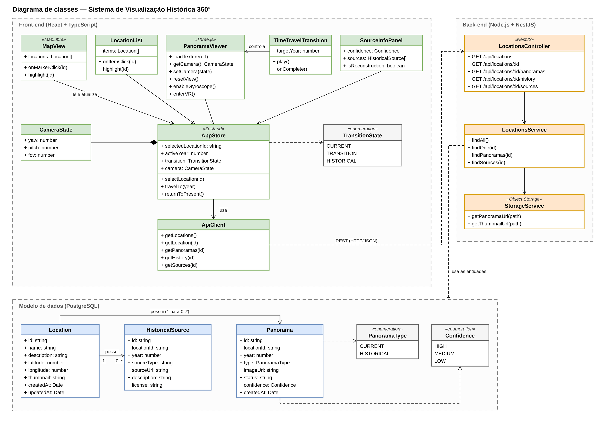
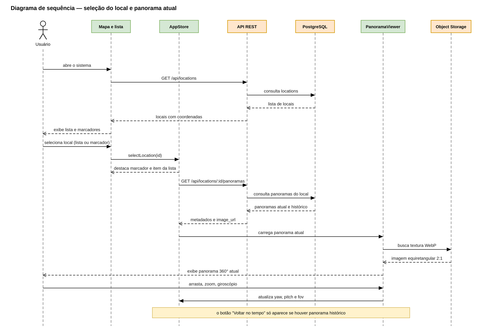
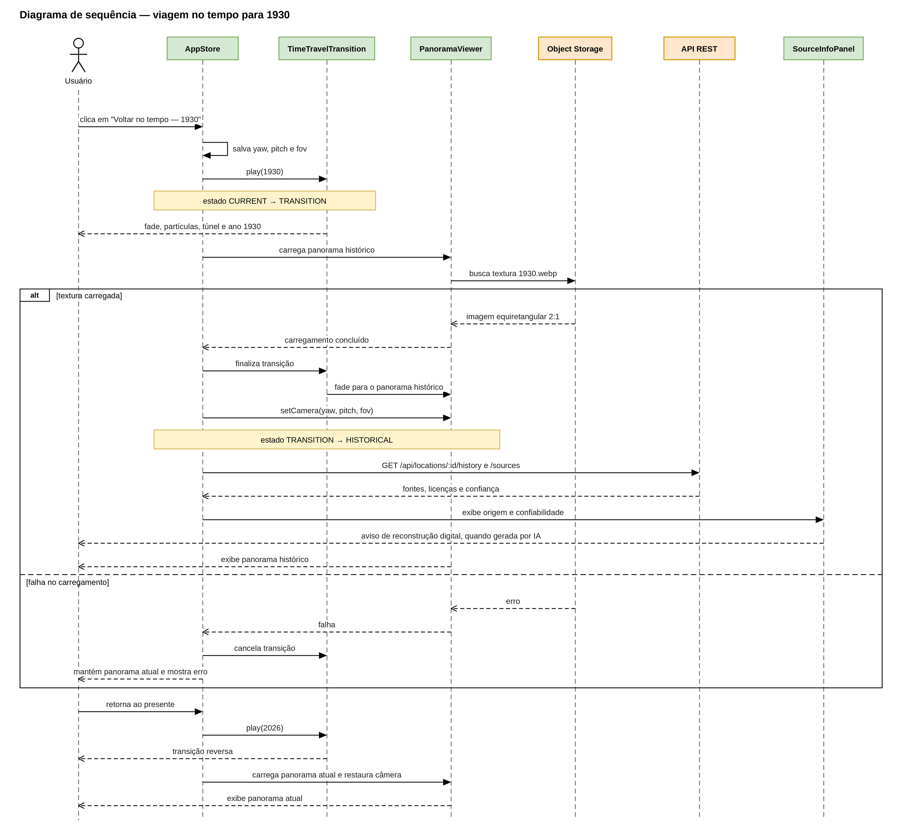

# Diagramas UML — Sistema de Visualização Histórica 360°

## Diagrama de classes

## Diagrama de sequência: seleção do local e panorama atual

## Diagrama de sequência: viagem no tempo para 1930

